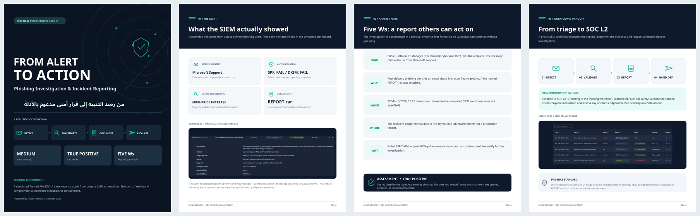

# SOC L1 Alert Reporting | Phishing Investigation Case Study

**Hands-on SOC Analyst L1 Case Study — TryHackMe (Simulated Lab)**

An evidence-based walkthrough of a post-delivery phishing alert investigated in a simulated Security Information and Event Management (SIEM) environment. The case focuses on alert triage, interpreting email-authentication findings, documenting the investigation using the **Five Ws**, and preparing escalation to a SOC L2 analyst.

> **Scope:** Educational laboratory scenario, not a live organizational incident. Observed findings and recommended response actions are clearly distinguished.

## Case overview

| Field | Finding |
|---|---|
| Alert | Email Marked as Phishing after Delivery |
| Alert severity | Medium |
| Lab classification | True Positive |
| Alert timestamp | March 27, 2025, 19:25 (as shown in lab) |
| Investigation method | Five Ws: Who, What, When, Where, Why |
| Escalation | SOC L1 → SOC L2 workflow |

## Technical evidence

- **Claimed sender:** An email presenting itself as Microsoft Support.
- **Email authentication:** SPF **Fail** and DKIM **Fail** in the alert record.
- **Social-engineering lure:** Urgent messaging about an alleged **600% Microsoft Teams price increase**.
- **Attachment:** `REPORT.rar`, requiring further controlled analysis.
- **Timing:** The email was flagged as phishing **after delivery** in the simulated environment.

**Analyst assessment:** In the context of this lab, the combined indicators support the **True Positive** phishing classification. They do not, by themselves, establish that the attachment was executed or that a device was compromised.

## Investigation workflow

`Alert Detection → Initial Triage → Evidence Review → Five Ws Report → Verdict → SOC L2 Escalation`

1. Reviewed the email alert and its associated SIEM fields.
2. Examined sender identity claims, authentication results, subject, body keywords, and attachment.
3. Recorded a concise Five Ws incident summary and supporting reasoning.
4. Classified the lab alert as **True Positive**.
5. Prepared the case for **SOC L2** follow-up, including attachment analysis, checking user interaction, scope assessment, and appropriate containment as **recommendations**, not completed actions.

## Report

**[View the full illustrated case study (PDF)](SOC_L1_Alert_Reporting_Visual_Case_Study.pdf)**

## Skills demonstrated

`SOC L1` · `Alert Triage` · `SIEM` · `Phishing Analysis` · `SPF` · `DKIM` · `Incident Reporting` · `Five Ws` · `Escalation`

## Training reference

[TryHackMe — SOC L1 Alert Reporting](https://tryhackme.com/room/socl1alertreporting)

---

**Author:** Munif Alomisi  
**Category:** Hands-on Cybersecurity Portfolio / Blue Team  
**Disclaimer:** This repository contains a training case study. No production infrastructure was accessed.
